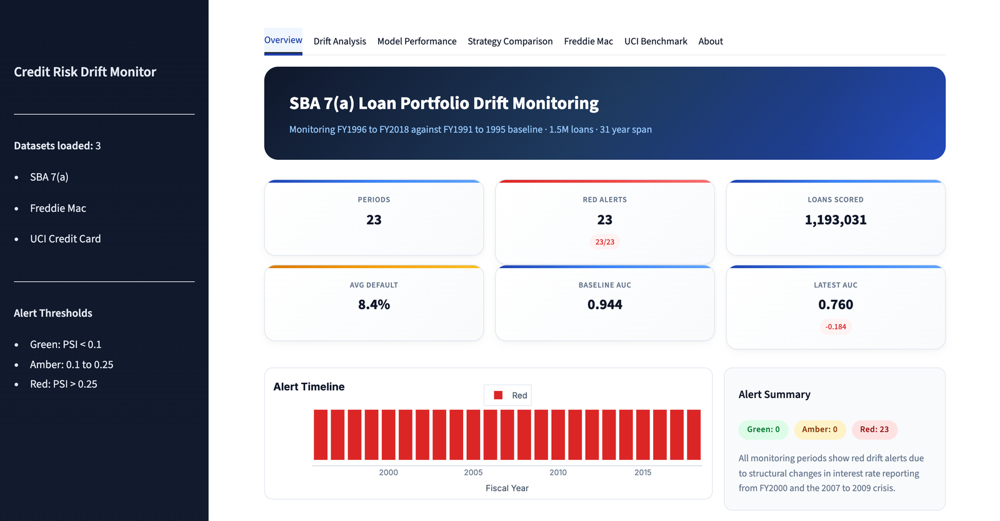
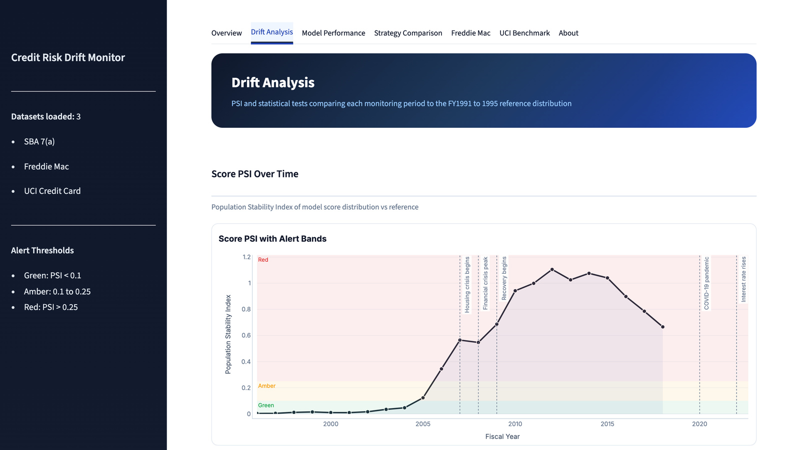
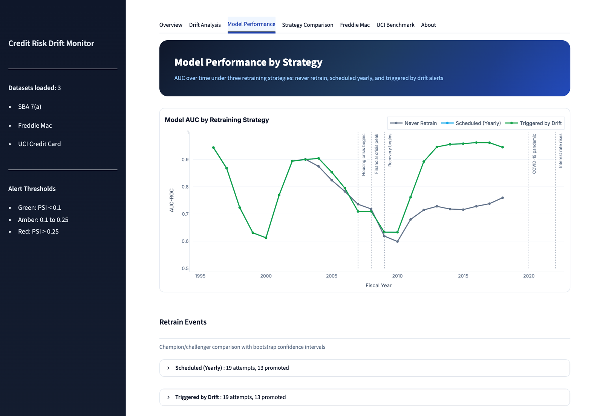
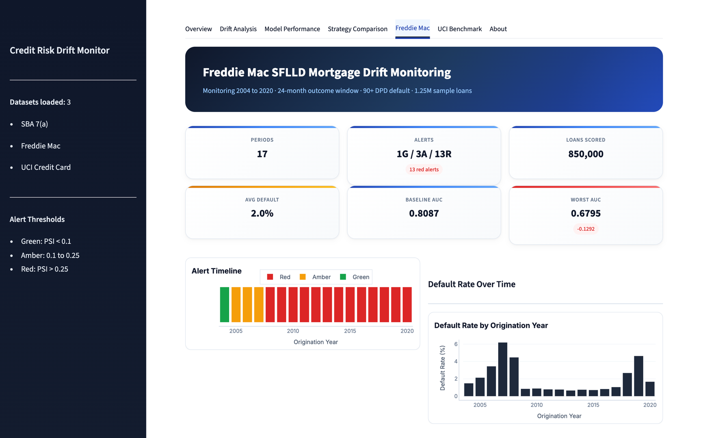
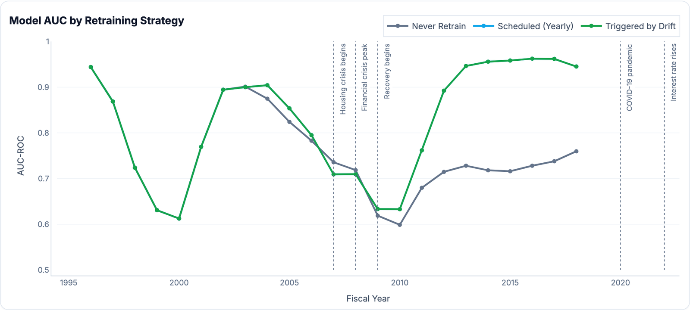
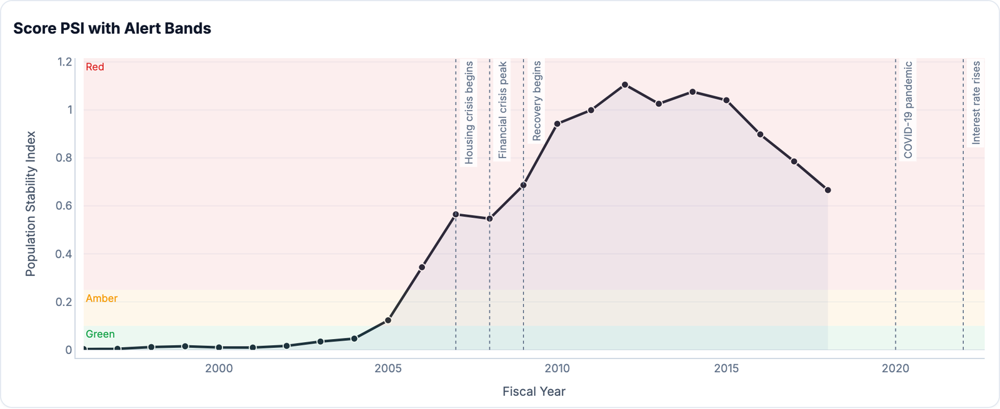
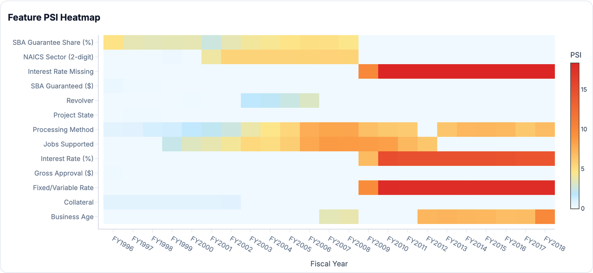
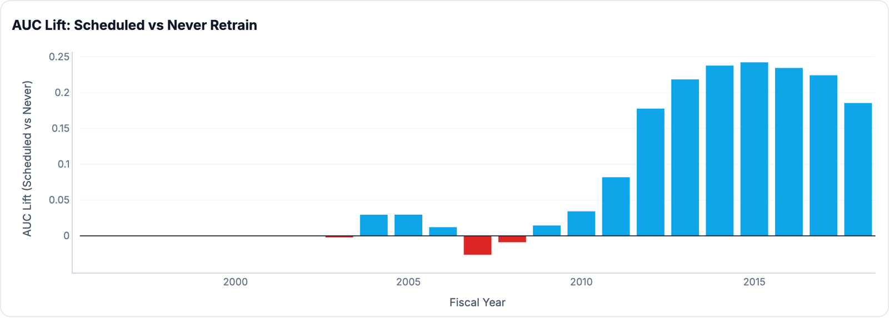
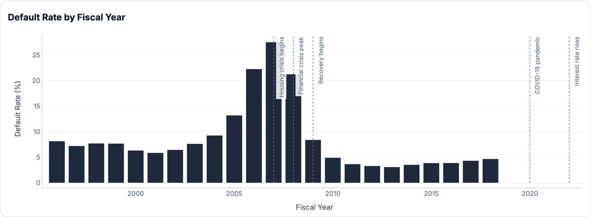
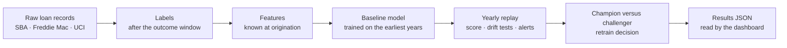

# Credit Risk Model Drift Monitoring

Measures how much a loan default model loses as the world changes around it, and what each retraining policy is worth in return. Built for credit risk and model governance teams.


**Live demo:** to be added once the app is deployed.



*The Overview screen. Every one of the 23 monitoring years raised a red drift alert, and the model's scoring quality fell from 0.944 to 0.760.*

## Contents

[The problem](#the-problem) · [Key results](#key-results) · [Dashboard tour](#dashboard-tour) · [Key charts](#key-charts) · [How it works](#how-it-works) · [Data](#data) · [Tech stack](#tech-stack) · [Run it locally](#run-it-locally) · [Project structure](#project-structure) · [Limitations and next steps](#limitations-and-next-steps)

## The problem

Lenders approve loans using a model trained on the past. Borrowers, the economy and even the paperwork keep changing, so the model slowly gets worse while still handing back confident looking scores. Most teams discover this when the losses show up, not when the drift starts.

This project replays that story on 1.2 million real small business loans and 850,000 real mortgages, measures the damage year by year, and compares three ways of responding.

## Key results

A model trained once on 1991 to 1995 loans and never updated was still scoring loans 23 years later. Here is what that cost, and what retraining recovered.

| Policy | What it does | Times retrained | Quality on new years | Quality on the final held back years |
|---|---|---|---|---|
| Never retrain | Keep the original model forever | 0 | 0.7513 | 0.7441 |
| Scheduled | Retrain every year | 13 | 0.8246 | **0.9251** |
| Triggered by drift | Retrain only when an alert turns red | 13 | 0.8246 | **0.9251** |

*Quality is AUC: the chance the model gives a loan that defaulted a higher risk score than one that did not. 0.50 is a coin toss, 1.00 is perfect.*

**What this means in plain terms**

- **Leaving the model alone cost about a fifth of its sorting power.** On three recent years the model had never seen, the stale model scored 0.7441 while the retrained one scored 0.9251.
- **The damage was worst in the years around the crash.** Defaults peaked at 27.5% on FY2007 loans, and the original model bottomed out two years later at 0.5987 on FY2010, much closer to guesswork than to its original 0.944.
- **Monitoring caught it early and kept catching it.** Score drift crossed the 0.25 red line in FY2006 and peaked at 1.10 in FY2012, more than four times the action threshold.
- **Retraining was not free money.** Of 19 attempts only 13 produced a model good enough to promote. The other 6 were rejected for failing to beat the model already in production.
- **On mortgages, waiting for an alert beat a fixed calendar.** Triggering on red alerts reached exactly the same accuracy as retraining every year, using 13 retraining runs instead of 16.

**What a risk team should do with this**

Run drift monitoring continuously, but let the alerts decide when to retrain rather than retraining on a calendar. On the mortgage book that choice saved three full retraining cycles at no cost to accuracy. On the small business book drift was constant, every period went red, and the two policies collapsed into the same answer. That is the honest finding: alert driven retraining is never worse, and is cheaper whenever drift is not constant.

## Dashboard tour

### Drift analysis



*Tracks how far each year's loans have moved from the 1991 to 1995 baseline, with the action thresholds drawn as coloured bands.*

### Model performance



*Compares the three policies year by year, and lists every retraining attempt with the decision that was made.*

### Freddie Mac mortgages



*The same pipeline on a second real dataset. Here the alerts are more selective, which is what makes the comparison between policies meaningful.*

## Key charts

### Retraining recovers what drift takes away



Both retrained policies sit on top of each other because every period triggered a retrain, so the green line hides the blue one. The grey line is the cost of doing nothing: after the crash it never recovers, ending 0.18 below the retrained models.

### Drift was flagged before the losses arrived



The score distribution sat flat in the green band for eight years, then climbed hard from FY2005. It crossed the red line in FY2006, the year before the housing crisis, and stayed there for the rest of the run. A team watching this chart had a dated, unambiguous signal while there was still time to act.

### What actually drifted



The three largest shifts are all interest rate fields, and they appear suddenly in FY2009: whether the rate is recorded at all, whether it is fixed or variable, and the rate itself. Their PSI jumps to around 18 and then stays flat, which is the signature of a reporting change rather than a change in borrowers. Drift monitoring cannot tell those two apart on its own, which is exactly why alerts need a human to read them.

### Retraining paid off in 13 of the 23 monitoring years



Blue bars are the 13 years where the retrained model beat the original, red bars the 3 where it was slightly worse, the largest of those being 0.026 in FY2007. From FY2013 the gain settles above 0.22, once crisis era loans are inside the training window.

### The business context behind the drift



Default rates on SBA 7(a) loans ran near 8% through the late 1990s, peaked at 27.5% for loans approved in FY2007, then settled between 3% and 5%. A model trained before this had no way to anticipate it.

## How it works



- **Labels respect the outcome window.** An SBA loan needs five years before anyone knows whether it was charged off, so a model retrained in FY2005 may only use loans approved up to FY2000. Nothing is trained on information that did not exist yet.
- **The split is fixed before anything runs.** The first five usable years train the baseline, the last three are held back and scored exactly once, and everything in between is monitoring.
- **Drift is measured three ways.** Population Stability Index on the score and on every feature, Kolmogorov Smirnov for numeric features, and chi-square for categorical ones. A period turns red if the score PSI passes 0.25, three or more features turn red, or AUC drops more than 0.02.
- **A new model has to earn its place.** Each challenger is trained on a rolling three year window and only replaces the champion if it beats it by at least 0.005 AUC on a held out year, confirmed with a 200 round bootstrap.
- **Results are written to JSON, and the dashboard only reads them.** The app never retrains, so what you see is exactly what the pipeline produced.

<details>
<summary><b>Method details</b></summary>

| Setting | Value |
|---|---|
| Models | Logistic Regression and HistGradientBoosting, tuned with time ordered cross validation |
| Winning model | HistGradientBoosting on both real datasets |
| Random seed | 42, fixed everywhere |
| SBA features | 8 numeric and 9 categorical, 17 total, all known at origination |
| SBA outcome window | 5 years |
| Freddie Mac outcome window | 24 months, default is 90 or more days delinquent or a credit related zero balance |
| Reference window | First 5 usable years |
| Final evaluation | Last 3 usable years, scored once |
| Rolling retrain window | 3 years |
| Promotion threshold | 0.005 AUC, with a 200 round bootstrap confidence interval |
| PSI bins | 10, quantile based for numeric features and equal width for scores |
| Alert thresholds | Green below 0.10, amber 0.10 to 0.25, red above 0.25 |
| Rare category grouping | Categories below 0.5% of the training window are folded into Other |
| Cost assumption | A missed default is treated as 5 times more costly than a false alarm |

**Why scheduled and triggered retraining tie on SBA.** All 23 monitoring periods are red, so the drift triggered policy fires every year and becomes identical to the yearly schedule. This is a real property of the data, not a bug. The 2007 to 2009 crisis reshaped default patterns and interest rate reporting changed structurally in FY2009, so there is no quiet period for the alert to skip. On Freddie Mac, where 4 of 17 periods are green or amber, the two policies separate: the same result from 13 retraining runs instead of 16.

**Freddie Mac alerts are driven by features, not scores.** The score PSI never leaves green on Freddie Mac, peaking at 0.058. Every red period there comes from feature level drift. Origination channel and original interest rate are among the top three drifting features in all 13 red periods, and original unpaid balance in 8 of them. Monitoring the model output alone would have missed all of it.

</details>

## Data

| Dataset | Source | Period | Size | Terms |
|---|---|---|---|---|
| SBA 7(a) FOIA | [data.sba.gov](https://data.sba.gov/dataset/7a-504-foia) | FY1991 to 2021 | about 1.5M loans | Public record, free to download |
| Freddie Mac Single Family Loan Level | [freddiemac.com](https://www.freddiemac.com/research/datasets/sf-loanlevel-dataset) | 1999 to 2023 | 1.25M sample loans | Registration required, internal use only, no redistribution |
| UCI Default of Credit Card Clients | [UCI repository](https://archive.ics.uci.edu/dataset/350/default+of+credit+card+clients) | 2005, Taiwan | 30,000 clients | Open, downloaded automatically |

No raw data and no trained model files are stored in this repository. Freddie Mac's terms do not allow redistribution, so only code and aggregated results are committed. Everything the dashboard shows comes from the JSON files in `reports/`, which are small enough to version.

The UCI dataset is used only as a controlled benchmark for the drift detectors, with drift injected deliberately so the detectors can be checked against a known answer. `SEX` and `MARRIAGE` are dropped from the model inputs, and `AGE` is monitored but never used as a feature.

## Tech stack

Python 3.14 · pandas · scikit-learn · SciPy · Plotly · Streamlit · pytest

## Run it locally

The dashboard reads the committed results, so it runs without any raw data.

```bash
git clone https://github.com/vamshidharsingh/credit-risk-model-drift-monitoring.git
cd credit-risk-model-drift-monitoring
```

```bash
python3 -m venv .venv
source .venv/bin/activate
pip install -r requirements.txt
```

```bash
streamlit run streamlit_app.py
```

```bash
pytest tests/ -v
```

To regenerate the results from scratch you need the raw data in `data/`, then:

```bash
python -c "from drift.freddie.benchmark import run_freddie_benchmark; run_freddie_benchmark()"
```

```bash
python -c "from drift.uci.benchmark import run_uci_benchmark; run_uci_benchmark()"
```

## Project structure

```
credit-risk-model-drift-monitoring/
├── drift/
│   ├── config.py          All settings, thresholds and paths in one place
│   ├── features.py        Feature engineering, origination time fields only
│   ├── pipeline.py        Training pipelines for both model families
│   ├── drift.py           PSI, KS and chi-square detection
│   ├── replay.py          Walks the model forward through the monitoring years
│   ├── retrain.py         Champion and challenger logic for the three policies
│   ├── label_delay.py     Enforces that no future information is used
│   ├── splits.py          Fixed time ordered reference, monitoring and evaluation split
│   ├── metrics.py         AUC, calibration and cost sensitive thresholds
│   ├── charts.py          Shared Plotly styling
│   ├── sba/               SBA 7(a) loader and label derivation
│   ├── freddie/           Freddie Mac loader, labels and full pipeline
│   └── uci/               UCI loader and the synthetic drift benchmark
├── streamlit_app.py       The dashboard
├── reports/               Pipeline output as JSON, read by the dashboard
├── docs/
│   ├── decisions.md       Every design decision and the reasoning behind it
│   └── images/            Screenshots used in this README
├── tests/                 59 tests covering drift maths, labels and splits
└── WALKTHROUGH.md         The same story in plain English, for non specialists
```

## Limitations and next steps

- **Two real datasets both show near constant drift**, so the comparison between scheduled and alert driven retraining only separates on Freddie Mac. A book with quieter stretches would test the alert logic harder.
- **The largest SBA drift signal is a reporting change, not borrower behaviour.** The interest rate fields shift in FY2009 and then sit flat, which is how a change in record keeping looks. The pipeline scores it the same as a real population shift, so separating the two still needs a human reading the feature level alerts.
- **Freddie Mac uses the public sample files, not the full dataset.** The sample is a 1 in 20 draw, so small year to year movements carry more noise than they would on the full book.
- **Retraining only ever uses a rolling three year window.** Longer windows, sample weighting and online updating would all be worth comparing, and the framework is set up to take them.

## Author

**Vamshi**

[GitHub @vamshidharsingh](https://github.com/vamshidharsingh) · [LinkedIn](https://www.linkedin.com/in/vamshidhars1/)
